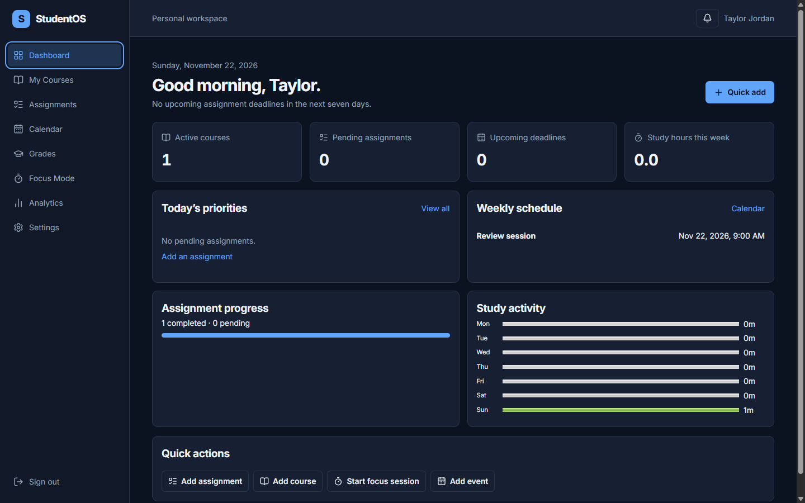
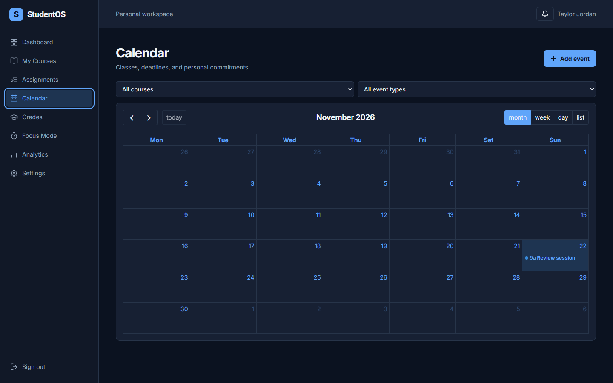

# StudentOS

**Your semester. Your schedule. Your space.**

StudentOS is a React/Vite workspace for courses, assignments, calendars, grades, focus sessions, analytics, and reminders. It uses the modular Firebase Authentication and Cloud Firestore SDKs. The production frontend is static and can use Firebase Hosting or Vercel.

## Firebase Console setup

1. Open project **studentos-4b78c**. Keep the project on Spark.
2. In **Project settings → Your apps**, register a Web app or select the existing one. Copy its Web configuration to a local `.env` using `.env.example`. Set `VITE_FIREBASE_API_KEY`, `VITE_FIREBASE_APP_ID`, and the matching `VITE_FIREBASE_AUTH_DOMAIN`. The project ID is already set in the example. These are public browser configuration values. Keep Admin credentials out of all `VITE_` variables.
3. In **Authentication → Sign-in method**, enable **Email/Password**. Add your production hostname under **Authorized domains**, and add `localhost` if you intend to use your live project in local development. Set the password policy minimum to 10 characters to match StudentOS. Enable email enumeration protection where available.
4. In **Firestore Database**, create the default database in Native mode. Start with locked rules and deploy this repository’s rules and indexes before opening the app to users.
5. In **Authentication → Templates → Password reset**, customize the action URL to `https://YOUR_HOST/reset-password` to use StudentOS’s reset form. The Firebase-hosted action page works with the default URL. Keep the Firebase-hosted action handler for email changes, which uses Firebase’s verification link.

## Run locally

Use Node 24 and Java 21 or newer. Install dependencies with `npm ci`.

- Terminal 1 runs `npm run emulators`. The Auth and Firestore emulators use the isolated `demo-studentos` project and ports 9099 and 8080.
- In terminal 2, set `VITE_FIREBASE_EMULATORS=true` and run `npm run dev`. In PowerShell, use `$env:VITE_FIREBASE_EMULATORS = 'true'`.
- Open `http://localhost:5173`. The app prints the actual URL if that port is busy. Leave the emulator variable off to connect to the live project with your Web configuration. Production builds ignore the emulator switch.

## Verify and deploy

- With the emulators running, `npm test` runs unit, component, and Firebase emulator integration tests.
- With the emulator-configured Vite app running, `npm run e2e -- --browser chrome` runs the student journey. Use `--config baseUrl=http://localhost:5174` if Vite chose that port. If the local shell sets `ELECTRON_RUN_AS_NODE`, clear it before running Cypress.
- `npm run lint` and `npm run build` check the source and produce `client/dist`.
- After logging into Firebase CLI with an authorized account, run `npx firebase deploy --project studentos-4b78c --only firestore:rules,firestore:indexes`. For Firebase Hosting, build with production environment values and run `npx firebase deploy --project studentos-4b78c --only hosting`. Alternatively, configure the same variables in Vercel and deploy the repository root.
- Validate account signup, reset delivery, and sign-in on the deployed hostname before inviting real users.

## Architecture and quotas

Firebase Authentication owns credentials and password reset codes. Firestore data lives under `users/{uid}/{collection}/{id}`, with explicit collection access and ownership checks. Rules validate document types, key sets, and core relationships. Forms enforce additional constraints including nested checklist and schedule entries. Existing pages and styling are retained. Route-level lazy imports keep Calendar, Analytics, and auth forms out of the entry chunk.

In-app reminders run when the signed-in application is visible. They persist to Firestore using deterministic IDs. For unattended in-app or email reminders, run `npm run reminders` on a machine you already operate, or use your machine’s scheduler with `npm run reminders -- --once`. It requires Admin Application Default Credentials and `FIREBASE_PROJECT_ID`. For email, also set `SMTP_URL`, `MAIL_FROM`, and HTTPS `STUDENTOS_URL` using `.env.reminders.example` as a reference. `MAIL_PER_MINUTE` defaults to 10 per worker. Users verify the recipient address from Settings before email delivery. Keep credentials server-side. Run one worker to enforce that global limit. If delivery is interrupted after a send attempt, inspect the record before retrying. With the worker stopped, in-app notices still work when StudentOS is visible and scheduled emails pause. Firebase password resets are delivered by Firebase, independently of the worker.

Spark has Firestore read/write and storage quotas. The browser loads relevant collections for schedules and analytics, and checks reminders once per minute while visible. This fits personal workspaces, but larger datasets and high user counts can reach quota. Course cascade deletes are batched atomically and subject to Firestore batch limits. Account deletion clears collections before deleting the Firebase identity. Retry account deletion if a network error interrupts cleanup.

## Legacy MongoDB cutover

No MongoDB writes or deletes are part of this migration. The local inspection found only Cypress and integration test database names. If another MongoDB deployment contains real data:

1. Back up the MongoDB database. Freeze legacy writes at cutover and retain the old database and deployment.
2. Export each account’s data through the prior StudentOS Settings **Export personal data** function. If only a database backup is available, restore it in a separate environment and run the read-only mongosh exporter. Set STUDENTOS_LEGACY_USER_ID and run mongosh with the restored database connection and --quiet --file tools/export-legacy.mongosh.js. Capture stdout as a UTF-8 legacy-account.json file. This script reads only one account and excludes all credentials. Keep export files private.
3. Create or identify the corresponding Firebase Auth identity. Verify ownership of the email address. For accounts provisioned with a temporary password, send a Firebase password reset before authorizing access. The importer preserves documents and relationships and does not copy custom JWT sessions or password hashes.
4. On a trusted machine, configure Admin Application Default Credentials and `FIREBASE_PROJECT_ID=studentos-4b78c`. Run `npm run import:legacy -- legacy-account.json FIREBASE_UID` for a dry run. After checking counts, append `--apply`. The importer checks the destination email and refuses to overwrite conflicting records.
5. Compare source and destination counts, sign in as the migrated user, and verify courses, assignment checklists, grades, calendar events, focus history, and preferences. Keep the source database until verification and rollback planning are complete.

## Screenshots

